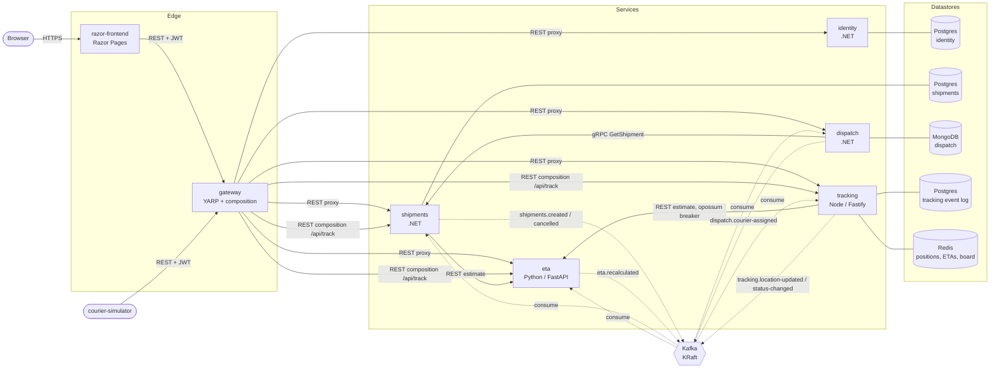

# Architecture

parcel-trace is seven deployable units: five back-end services, an API gateway and a web
frontend. Each back-end service owns its data. Services ask each other questions synchronously
(REST or gRPC) only when they need an answer right now. Anything that *happened* is published as
an event on Kafka.

## System diagram

Solid arrows are synchronous calls (REST, gRPC). Dotted arrows are asynchronous Kafka events.



## Services

| Service | Language | Port (local) | Store | Responsibility |
|---|---|---|---|---|
| `identity` | .NET 8 | 5101 | PostgreSQL `identity` | users, roles, BCrypt passwords, JWTs |
| `shipments` | .NET 8 | 5102, gRPC 5112 | PostgreSQL `shipments` | shipment lifecycle, quotes, tracking numbers, cancel window, SLA, outbox, gRPC server |
| `dispatch` | .NET 8 | 5103 | MongoDB `dispatch` | couriers, assignment saga (offers, timeouts, escalation), routes |
| `tracking` | Node 20 / Fastify 4 | 5104 | PostgreSQL `tracking` + Redis | pings, append-only timeline, projections, dispatcher board, public view |
| `eta` | Python 3.12 / FastAPI | 5105 | none (stateless) | ETA model, recalculation on pings |
| `gateway` | .NET 8 / YARP 2.1 | 8080 | – | entry point: JWT, rate limiting, routing, `/api/track` composition, aggregated Swagger |
| `razor-frontend` | .NET 8 Razor Pages | 8000 | – | UI for customers, dispatchers, couriers, admins and the public |

Code: [src/services](../src/services), [src/gateway](../src/gateway), [src/razor-frontend](../src/razor-frontend).
Shared .NET plumbing: [shared/ParcelTrace.BuildingBlocks](../shared/ParcelTrace.BuildingBlocks).
Shared contracts: [shared/ParcelTrace.Contracts](../shared/ParcelTrace.Contracts) and [shared/protos](../shared/protos).

## Data ownership

No service reads another service's tables. Locally one Postgres server hosts three separate
databases ([deploy/postgres/init.sql](../deploy/postgres/init.sql)); in Azure they are three
databases on one Flexible Server (created by the optional Terraform in
[infra/terraform/modules/postgres-flexible](../infra/terraform/modules/postgres-flexible), or an existing server).

| Data | Owner | Store | Why this store |
|---|---|---|---|
| Users, roles, password hashes | identity | PostgreSQL | small relational data, unique emails, transactions |
| Shipments, outbox, processed messages | shipments | PostgreSQL | the outbox needs the shipment change and its event in **one ACID transaction**; `xmin` gives optimistic concurrency |
| Couriers, assignment sagas, assignments, queue | dispatch | MongoDB | courier and saga documents are read and replaced whole (offer lists, held shipment ids); conditional single-document updates give atomic capacity reservation and saga versioning; flexible schema while the saga evolves |
| Timeline event log, shipment projection, ping history, ETAs | tracking | PostgreSQL | append-only log with per-shipment sequence and a trigger enforcing immutability; projections rebuilt with plain SQL |
| Latest positions, cached ETAs, dispatcher board | tracking | Redis | hot keys overwritten constantly and read on every page load; hashes and counters are cheap and fast |
| Nothing | eta | – | a pure calculation; scales horizontally with no state |

Other services keep **their own copy** of what they need, filled from events. Tracking keeps the
reference data of each shipment in its projection; dispatch keeps the queue entry from
`shipments.created`. When dispatch needs authoritative, current data (status, weight, pick-up), it
asks shipments over gRPC.

## Synchronous paths

| From → to | Protocol | Why synchronous |
|---|---|---|
| frontend → gateway | REST | the UI needs an answer |
| gateway → every service | REST (YARP proxy) | single entry point |
| gateway → shipments, tracking, eta | REST (composition) | the public page needs data owned by three services |
| dispatch → shipments | gRPC `ShipmentLookup.GetShipment` | current status and pick-up when making an offer |
| shipments → eta | REST `POST /api/eta/estimate` | initial ETA at booking (optional; booking works without it) |
| tracking → eta | REST `POST /api/eta/estimate` | refresh a stale ETA on a public lookup |

Every one of these clients has retry, timeout and circuit breaking. See
[design-patterns.md](design-patterns.md#circuit-breaker--retry--timeout).

## Event and topic catalog

Every event uses one envelope, the same in C#, JavaScript and Python:

```json
{ "eventId": "uuid", "eventType": "ShipmentCreated", "schemaVersion": 1, "occurredAt": "2024-…Z", "payload": { } }
```

Headers: `event-type`, `traceparent` / `tracestate` (W3C trace context), and on retries
`retry-count`, `original-topic`, `error`. Messages are keyed by shipment id (pings by courier id),
so the events of one parcel stay in order on one partition.

| Topic | Producer | Consumers | Payload |
|---|---|---|---|
| `shipments.created` | shipments (outbox) | dispatch (queue + start saga), tracking (`Created` event) | ids, tracking number, customer, service level, pick-up and drop-off summary, weight, SLA, initial ETA |
| `shipments.cancelled` | shipments (outbox) | dispatch (end saga, free courier), tracking (`Cancelled` closes the timeline) | shipment id, courier id, reason |
| `dispatch.courier-assigned` | dispatch | shipments (status Assigned), tracking (`Assigned` event) | shipment id, courier id and name, mode `Auto`/`Manual` |
| `tracking.location-updated` | tracking | eta (recalculate), dispatch (courier position) | courier id, position, speed, the courier's open shipments with pick-up and destination |
| `tracking.status-changed` | tracking | shipments (status, proof), dispatch (frees the courier on Delivered/Failed) | shipment id, status, note, proof of delivery |
| `eta.recalculated` | eta | tracking (ETA store and cache), shipments (delay detection) | shipment id, ETA, minutes and km remaining, traffic factor |
| `<group>.retry` | each consumer group | the same group | a failed message plus retry headers |
| `<group>.dlq` | each consumer group | operators (Kafka UI) | messages that kept failing or could not be parsed |
| `parcel-trace.healthchecks` | .NET Kafka health checks | – | readiness probe writes |

Consumer groups: `shipments`, `dispatch`, `tracking`, `eta`. All topics are created up front by
[deploy/kafka/create-topics.sh](../deploy/kafka/create-topics.sh) (3 partitions; automatic topic
creation is off). Contracts: [shared/ParcelTrace.Contracts/Events.cs](../shared/ParcelTrace.Contracts/Events.cs).
