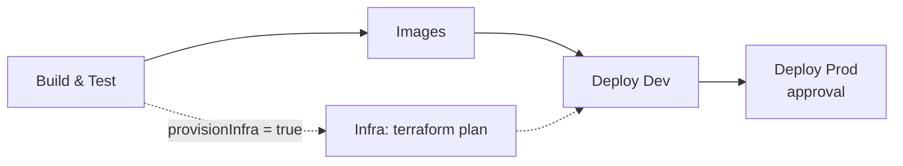

# Deployment

parcel-trace runs anywhere from a laptop to AKS. **Terraform is optional**: it is one way to create
the Azure resources, and nothing in the application or the Helm chart depends on it.

| Where | How | Needs Azure | Needs Terraform |
|---|---|---|---|
| One machine | [Docker Compose](#docker-compose) | no | no |
| Any Kubernetes cluster (kind, Docker Desktop, minikube, …) | [Helm with `values-local.yaml`](#any-kubernetes-cluster-values-localyaml) | no | no |
| Azure, resources created for you | [Terraform](#terraform-optional), then Helm with `values-dev.yaml` / `values-prod.yaml` | yes | yes |
| Azure, resources that already exist | [Helm values or pipeline variables](#azure-without-terraform) | yes | no |

Every option can be validated locally without an Azure account (see [Validating locally](#validating-locally)).

## Docker Compose

[docker-compose.yml](../deploy/docker-compose.yml) runs:
- the 7 services
- Postgres (three databases), MongoDB and Redis
- Kafka in KRaft mode, a one-shot `kafka-init` container that creates every topic, and Kafka UI
- Jaeger

These are the local equivalents of everything Terraform would create in Azure (Postgres instead of
Azure Database for PostgreSQL, an `.env` file instead of Key Vault, Jaeger instead of Azure Monitor).

Every datastore and service has a health check, and services start only after their dependencies
are healthy and the topics exist.
[docker-compose.override.yml](../deploy/docker-compose.override.yml) publishes each service and
datastore on a localhost port for debugging.

```bash
cp .env.example .env          # sets COMPOSE_FILE to both files
docker compose up --build
docker compose config -q      # validate
docker compose down -v        # stop and drop the volumes
```

All images use multi-stage builds with pinned tags and run as non-root users.

## The Helm chart

[deploy/helm/parcel-trace](../deploy/helm/parcel-trace) is an umbrella chart. Every service comes
from one reusable template, [_service.tpl](../deploy/helm/parcel-trace/templates/_service.tpl),
which renders:
- a ConfigMap
- a Deployment with liveness, readiness and startup probes, resource requests and limits, a non-root user and dropped capabilities
- a ClusterIP Service
- an optional `autoscaling/v2` HPA

Other templates:

| Template | What it renders |
|---|---|
| [secret.yaml](../deploy/helm/parcel-trace/templates/secret.yaml) | a Kubernetes Secret built from `secrets.values` (local and dev) |
| [serviceaccount.yaml](../deploy/helm/parcel-trace/templates/serviceaccount.yaml) | the pods' ServiceAccount; with `workloadIdentity.enabled` it carries the AKS workload identity client id |
| [ingress.yaml](../deploy/helm/parcel-trace/templates/ingress.yaml) | a `networking.k8s.io/v1` Ingress with the NGINX class, for the web app and the gateway only |
| [kafka-topics-job.yaml](../deploy/helm/parcel-trace/templates/kafka-topics-job.yaml) | a post-install Job that creates the topics |

| Values | Target | What it changes |
|---|---|---|
| [values.yaml](../deploy/helm/parcel-trace/values.yaml) | baseline | images, shared env, secret key mapping, ingress; workload identity off, datastores off |
| [values-local.yaml](../deploy/helm/parcel-trace/values-local.yaml) | any cluster, no Azure | in-cluster PostgreSQL, MongoDB, Redis and Kafka; a plain Kubernetes Secret; workload identity off; local images; `*.localhost` hosts; tracing exporters off |
| [values-dev.yaml](../deploy/helm/parcel-trace/values-dev.yaml) | AKS dev | one replica each, in-cluster datastores, a generated dev Secret, workload identity on |
| [values-prod.yaml](../deploy/helm/parcel-trace/values-prod.yaml) | AKS prod | HPAs, TLS via cert-manager, managed datastores, `existingSecret` synced from Key Vault, workload identity on |

The Bitnami PostgreSQL, MongoDB, Redis and Kafka charts are declared in
[Chart.yaml](../deploy/helm/parcel-trace/Chart.yaml) behind `postgresql.enabled`,
`mongodb.enabled`, `redis.enabled` and `kafka.enabled`. Local and dev turn them on; prod points at
managed services instead.

## Any Kubernetes cluster (`values-local.yaml`)

No Azure, no Terraform, no registry. Build the images with the tag `local` and make them visible to
the cluster:

```bash
for svc in identity shipments dispatch; do
  docker build -t parcel-trace/$svc:local -f src/services/$svc/Dockerfile .
done
docker build -t parcel-trace/gateway:local  -f src/gateway/Dockerfile .
docker build -t parcel-trace/frontend:local -f src/razor-frontend/Dockerfile .
docker build -t parcel-trace/tracking:local src/services/tracking
docker build -t parcel-trace/eta:local      src/services/eta

# kind only (Docker Desktop's Kubernetes already sees local images):
for img in identity shipments dispatch gateway frontend tracking eta; do kind load docker-image parcel-trace/$img:local; done
```

Then install:

```bash
helm dependency build deploy/helm/parcel-trace
helm upgrade --install pt deploy/helm/parcel-trace \
  -f deploy/helm/parcel-trace/values-local.yaml \
  -n parcel-trace --create-namespace
```

With an NGINX ingress controller in the cluster, the app is at `http://parcel-trace.localhost` and
the API at `http://api.parcel-trace.localhost`. Without one, port-forward instead:

```bash
kubectl -n parcel-trace port-forward svc/pt-frontend 8000:80
kubectl -n parcel-trace port-forward svc/pt-gateway 8080:80
```

The services run in Development mode, so identity and shipments migrate and seed on start and the
demo logins work. The same courier simulator can be pointed at the port-forwarded gateway
(`GATEWAY_URL=http://localhost:8080`).

## Azure without Terraform

If the cluster, registry and databases already exist (created by hand, by another team, or with
other tooling), skip Terraform and hand their names to Helm or the pipeline.

What has to exist:

| Resource | Used for |
|---|---|
| AKS cluster with an NGINX ingress controller | running the chart |
| a container registry the cluster can pull from | the seven images |
| PostgreSQL with the `identity`, `shipments` and `tracking` databases | identity, shipments, tracking |
| MongoDB, Redis and Kafka endpoints | dispatch, tracking, messaging |
| a Kubernetes Secret with the keys in `secretEnv` (`jwt-signing-key`, `identity-db`, `shipments-db`, `tracking-db-url`, `mongo-url`, `redis-url`) | connection strings and the JWT key |

Pass them as Helm values, for example:

```bash
helm upgrade --install parcel-trace deploy/helm/parcel-trace \
  -f deploy/helm/parcel-trace/values-prod.yaml \
  --set global.imageRegistry=myregistry.azurecr.io \
  --set global.imageTag=1.0.0 \
  --set global.env.Kafka__BootstrapServers=kafka.internal:9092 \
  --set secrets.existingSecret=parcel-trace-secrets \
  --set workloadIdentity.clientId=00000000-0000-0000-0000-000000000000
```

In the pipeline, the same names come from the `parcel-trace-common` variable group
(`acrLoginServer`, `aksResourceGroupDev`, `aksClusterDev`, `aksResourceGroupProd`,
`aksClusterProd`) and `provisionInfra` stays `false`. If the cluster doesn't use workload
identity, also set `workloadIdentity.enabled=false`.

## Terraform (optional)

[infra/terraform](../infra/terraform) creates the Azure side for you (azurerm 3.x):

| Module | Creates |
|---|---|
| [resource-group](../infra/terraform/modules/resource-group) | the environment's resource group |
| [log-analytics](../infra/terraform/modules/log-analytics) | workspace for Container Insights (log aggregation) |
| [acr](../infra/terraform/modules/acr) | container registry, no admin user |
| [aks](../infra/terraform/modules/aks) | VNet and subnet; AKS with a system pool (critical add-ons only) and an autoscaling user pool; Azure CNI and network policy; OIDC issuer and workload identity; Key Vault CSI driver; Container Insights; the **AcrPull** role assignment for the kubelet identity |
| [postgres-flexible](../infra/terraform/modules/postgres-flexible) | PostgreSQL 16 Flexible Server, the three databases, TLS required, generated admin password |
| [keyvault](../infra/terraform/modules/keyvault) | RBAC Key Vault, roles for the deployer and the AKS CSI identity, the secrets the chart expects |

[envs/dev](../infra/terraform/envs/dev) and [envs/prod](../infra/terraform/envs/prod) wire the
modules together:
- **Naming:** `rg-parcel-trace-dev`, `aks-parcel-trace-prod`, `acrparceltracedev`, …
- **Tags:** `application`, `environment`, `managed-by`, `cost-center`
- **State:** an `azurerm` backend in a Storage account (placeholder names)
- **Prod adds:** zones, an uptime-SLA cluster, zone-redundant HA Postgres with geo-redundant backups, and purge protection on the vault

`terraform.tfvars.example` holds placeholder values only. The outputs (`acr_login_server`,
`aks_name`, `key_vault_uri`, …) are exactly the names the [previous section](#azure-without-terraform)
asks for, so Terraform simply fills in that list.

## Azure DevOps pipeline

[azure-pipelines.yml](../azure-pipelines.yml) triggers on `main` and on pull requests, with path
filters, the `parcel-trace-common` variable group, and the `acr-connection` / `azure-arm-connection`
service connections (placeholders).

| Stage | Template | What it does |
|---|---|---|
| 1. Build & Test | [build-test.yml](../deploy/pipelines/templates/build-test.yml) | `DotNetCoreCLI@2` restore/build/test (Testcontainers included), test results and Cobertura coverage; vitest and pytest with JUnit results; compose config, `helm lint` and `helm template` with the dev, prod and local values |
| 2. Images | [docker-images.yml](../deploy/pipelines/templates/docker-images.yml) | `Docker@2` build and push of the seven images to ACR |
| 3. Infra (optional) | [terraform.yml](../deploy/pipelines/templates/terraform.yml) | `TerraformTaskV4@4` init, validate and plan for dev and prod; plans published as artifacts (apply stays a deliberate manual step). Only included when `provisionInfra` is `true` |
| 4. Deploy Dev | [helm-deploy.yml](../deploy/pipelines/templates/helm-deploy.yml) | `HelmDeploy@0` `upgrade --install --atomic` with `values-dev.yaml` |
| 5. Deploy Prod | same template | with `values-prod.yaml`, as a deployment job on the `parcel-trace-prod` environment, whose approval check gates it |

`provisionInfra` is a boolean pipeline parameter, **`false` by default**. With `false` the Infra
stage isn't generated at all (no Terraform task, state or Azure credentials needed for it), and
Deploy Dev waits only for the images. Set it to `true` when queueing a run to add the plan stage;
Deploy Dev then also waits for it.



## Validating locally

None of these touch Azure:

```bash
# compose
docker compose -f deploy/docker-compose.yml config -q

# helm, all three targets
helm dependency build deploy/helm/parcel-trace
for v in dev prod local; do
  helm lint deploy/helm/parcel-trace -f deploy/helm/parcel-trace/values-$v.yaml
  helm template pt deploy/helm/parcel-trace -f deploy/helm/parcel-trace/values-$v.yaml > /dev/null
done

# terraform (only if you use it)
cd infra/terraform && terraform fmt -check -recursive
cd envs/dev  && terraform init -backend=false && terraform validate
cd ../prod   && terraform init -backend=false && terraform validate
```
