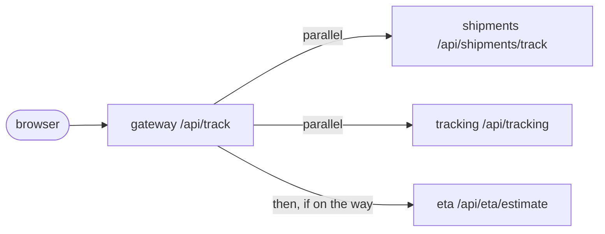
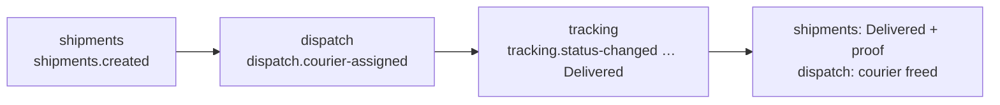

# Design patterns

Each section covers one microservice pattern used in parcel-trace: the problem it solves here,
how it is implemented (with links to the code), and the trade-offs. Patterns were added only
where they solve a real problem in this domain.

| Pattern | Where |
|---|---|
| [API Gateway](#api-gateway) | `gateway` |
| [API Composition](#api-composition) | `gateway` → shipments + tracking + eta |
| [Database per Service + Polyglot Persistence](#database-per-service--polyglot-persistence) | every service |
| [Choreography-based Saga](#choreography-based-saga) | shipment lifecycle across shipments, dispatch, tracking |
| [Orchestration-based Saga](#orchestration-based-saga) | courier assignment in `dispatch` |
| [Transactional Outbox](#transactional-outbox) | `shipments` |
| [Idempotent Consumer](#idempotent-consumer) | every consumer |
| [Event Sourcing (light)](#event-sourcing-light) | `tracking` timeline |
| [CQRS](#cqrs) | `tracking` read models |
| [Circuit Breaker + Retry + Timeout](#circuit-breaker--retry--timeout) | every HTTP/gRPC client; `opossum` in Node |
| [Cache-Aside](#cache-aside) | `tracking`: positions and ETAs in Redis |
| [Retry Topic + Dead Letter Topic](#retry-topic--dead-letter-topic) | every consumer group |
| [Distributed Tracing](#distributed-tracing) | HTTP, gRPC and Kafka |
| [Health Check API, Externalized Configuration, Log Aggregation](#health-check-api-externalized-configuration-log-aggregation) | every service |

---

## API Gateway

**Problem.** Seven services with different addresses, auth checks and rate limits would leak into
every client, and every service would be exposed to the internet.

**Implementation.** [YARP](../src/gateway/ParcelTrace.Gateway/appsettings.json) routes `/api/*` to
the owning service. The gateway:
- validates the JWT ("signed in or not")
- applies rate limits ([RateLimiting.cs](../src/gateway/ParcelTrace.Gateway/RateLimiting.cs): `public` 60/min per IP, `login` 10/min per IP, `api` 300/min per user)
- checks downstream health ([DownstreamHealthCheck.cs](../src/gateway/ParcelTrace.Gateway/DownstreamHealthCheck.cs))
- serves one Swagger UI for every service

In Kubernetes only the gateway and the frontend get an Ingress
([ingress.yaml](../deploy/helm/parcel-trace/templates/ingress.yaml)).

**Trade-offs.** One more hop and one more thing to scale. Role checks deliberately stay in each
service (defence in depth), so the gateway only knows "signed in or not".

## API Composition

**Problem.** The public tracking page needs booking facts (SLA, service level, delivered-to) from
shipments, the timeline and courier position from tracking, and a fresh ETA from eta. Making the
browser call three services would expose them and triple the round trips.

**Implementation.** `GET /api/track/{trackingNumber}` is answered by the gateway itself
([TrackingComposition.cs](../src/gateway/ParcelTrace.Gateway/Composition/TrackingComposition.cs)).
It queries shipments and tracking **in parallel**. If the courier is on the way, it then asks eta
for a live estimate from the last position. Finally it merges everything into one response.

Each source is optional:
- tracking down → booking facts plus the booking-time ETA
- eta down → the last recalculated ETA

The `sources` field reports what was missing, and the frontend says so
([Track.cshtml.cs](../src/razor-frontend/ParcelTrace.Frontend/Pages/Track.cshtml.cs)).
Tests: [TrackingComposerTests.cs](../tests/ParcelTrace.Gateway.Tests/TrackingComposerTests.cs).

**Trade-offs.** The response is only as fresh as the slowest source within its 2 s budget. The
gateway now contains a little domain knowledge: which statuses mean "on the way".

## Database per Service + Polyglot Persistence

**Problem.** A shared database couples deployments and schemas, and lets one service break
another's invariants.

**Implementation.** Each service owns its store and nobody reads another's tables:

| Service | Store | Why |
|---|---|---|
| identity | PostgreSQL ([IdentityDbContext](../src/services/identity/ParcelTrace.Identity/Data/IdentityDbContext.cs)) | relational, unique emails |
| shipments | PostgreSQL ([ShipmentsDbContext](../src/services/shipments/ParcelTrace.Shipments/Data/ShipmentsDbContext.cs)) | the outbox needs the shipment and its event in one ACID transaction |
| dispatch | MongoDB ([DispatchDb](../src/services/dispatch/ParcelTrace.Dispatch/Data/DispatchDb.cs)) | courier and saga documents read and replaced whole; atomic conditional updates for capacity and saga versions |
| tracking | PostgreSQL ([001_init.sql](../src/services/tracking/migrations/001_init.sql)) + Redis | append-only log with per-shipment sequence; Redis for hot, constantly overwritten keys |
| eta | none | a pure function |

Data a service needs from others arrives as events and is kept locally (tracking's projection,
dispatch's queue). For authoritative, current values, dispatch asks shipments over gRPC
([shipments.proto](../shared/protos/shipments.proto)).

**Trade-offs.** No cross-service joins or transactions, hence the sagas, outbox and eventual
consistency below. More infrastructure to run and back up.

## Choreography-based Saga

**Problem.** A shipment's life spans three services, and no single transaction can cover them.

**Implementation.** No coordinator. Each service reacts to the previous service's event:

**Compensation:** a shipment cancelled after assignment publishes `shipments.cancelled`.
- dispatch ends the saga, withdraws an open offer, closes the assignment and frees the courier's capacity: `CancelAsync` in [AssignmentService.cs](../src/services/dispatch/ParcelTrace.Dispatch/Services/AssignmentService.cs)
- tracking appends a terminal `Cancelled` event that closes the timeline: `onShipmentCancelled` in [trackingService.js](../src/services/tracking/src/trackingService.js)

The [state machines](../src/services/shipments/ParcelTrace.Shipments/Domain/ShipmentStateMachine.cs) make
late or duplicate events harmless.

**Trade-offs.** The flow is implicit: you have to read several services (or [how-it-works.md](how-it-works.md))
to follow it. There is no single place that knows a parcel is "stuck"; for assignment that's why
the next pattern exists.

## Orchestration-based Saga

**Problem.** Assigning a courier is a multi-step conversation with timeouts. Offer to the
nearest courier, wait up to 2 minutes, move on after a rejection or silence, and escalate to a
human after 3 failures. Choreography would scatter that state across events.

**Implementation.** dispatch orchestrates the steps and persists the saga in the
`assignment_sagas` collection.

| Part | Where |
|---|---|
| State and rules | [AssignmentSaga.cs](../src/services/dispatch/ParcelTrace.Dispatch/Domain/AssignmentSaga.cs): `Offer`, `Accept`, `Reject`, `Expire`, `Cancel`, `AssignManually` |
| Orchestrator | [AssignmentService.cs](../src/services/dispatch/ParcelTrace.Dispatch/Services/AssignmentService.cs): picks the courier ([AutoAssigner](../src/services/dispatch/ParcelTrace.Dispatch/Domain/AutoAssigner.cs)), **holds their capacity** during the offer, publishes `dispatch.courier-assigned` on accept, releases the hold on reject / timeout / withdrawal |
| Timeouts | [AssignmentSagaWorker.cs](../src/services/dispatch/ParcelTrace.Dispatch/Services/AssignmentSagaWorker.cs) runs every 10 s: expires offers past their deadline and re-offers shipments waiting for a free courier |
| Courier API | `GET /api/dispatch/offers/me`, `POST /api/dispatch/offers/{id}/accept`, `POST …/reject` |
| Dispatcher API | `GET /api/dispatch/escalations`, `GET /api/dispatch/sagas/{id}`, and `POST /api/dispatch/assign` to resolve |
| Concurrency | every save is compare-and-swap on `Version`, so an accept racing a timeout can't both win |

The state diagram is in [how-it-works.md](how-it-works.md#assignment-saga). Tests:
- [AssignmentSagaTests.cs](../tests/ParcelTrace.Dispatch.UnitTests/AssignmentSagaTests.cs) (rules)
- [AssignmentServiceTests.cs](../tests/ParcelTrace.Dispatch.IntegrationTests/AssignmentServiceTests.cs) (real Mongo: accept, rejection, three timeouts → escalation, compensation)

**Trade-offs.** Dispatch is now a single place of truth that must stay available. Holding
capacity during an offer can briefly make a courier look busier than they are.

## Transactional Outbox

**Problem.** "Save the shipment, then publish to Kafka" is a dual write. A crash in between
either loses the event or publishes one for a change that never committed.

**Implementation.**
1. `OutboxWriter.Enqueue` ([OutboxWriter.cs](../src/services/shipments/ParcelTrace.Shipments/Outbox/OutboxWriter.cs)) adds an `outbox_messages` row in the **same `SaveChanges`** as the shipment change. The row stores the request's `traceparent`.
2. [OutboxPublisher.cs](../src/services/shipments/ParcelTrace.Shipments/Outbox/OutboxPublisher.cs) claims rows with `FOR UPDATE SKIP LOCKED` (safe with several replicas) and publishes them in creation order. It stops at the first failure so events for a shipment can't overtake each other, then marks them published.
3. Old rows are cleaned up after 7 days.

**Trade-offs.**
- At-least-once (consumers must be idempotent).
- Up to one poll interval (1 s) of latency.
- Rows that fail 20 times are no longer retried and need attention.

## Idempotent Consumer

**Problem.** Kafka delivery is at-least-once (rebalances, restarts, retry topics), so every
handler sees duplicates.

**Implementation.** Processed-event tracking in every consumer:

| Consumer | Mechanism |
|---|---|
| shipments | `processed_messages` row written in the **same transaction** as the change ([ShipmentEventHandler.cs](../src/services/shipments/ParcelTrace.Shipments/Messaging/ShipmentEventHandler.cs)) |
| dispatch | `processed_events` collection with a 7-day TTL index ([DispatchConsumer.cs](../src/services/dispatch/ParcelTrace.Dispatch/Messaging/DispatchConsumer.cs)); handlers are repeat-safe too (upserts, guarded capacity release, saga versioning) |
| tracking | `processed_events` table ([consumers.js](../src/services/tracking/src/consumers.js)) and a unique `source_event_id` on the event log, so a second append is impossible |
| eta | bounded in-memory LRU of event ids ([idempotency.py](../src/services/eta/app/idempotency.py)); a stateless service has no table, and a replay after restart recomputes the same ETA |

Producers are idempotent too (`acks=all`, `enable.idempotence`).

**Trade-offs.** Bookkeeping writes on every message; dispatch's marker is written after the
handler (no Mongo transaction), so the handlers themselves must also be idempotent.

## Event Sourcing (light)

**Problem.** The tracking timeline is history. Customers and support want to know what happened
when, not only the current status, and the current status must never disagree with that history.

**Implementation.**
- **The log.** `shipment_events` is append-only, with a per-shipment `sequence`. A database trigger rejects every `UPDATE` and `DELETE` ([001_init.sql](../src/services/tracking/migrations/001_init.sql)).
- **The projection.** The current status, courier and reference data form a pure left fold over the events ([projection.js](../src/services/tracking/src/projection.js)).
- **Appending.** [eventStore.js](../src/services/tracking/src/eventStore.js) locks the shipment's projection row, inserts the next event and applies it to the projection, all in one transaction.
- **Rebuilding.** `npm run rebuild` ([rebuild.js](../src/services/tracking/src/rebuild.js)) or `POST /api/tracking/admin/rebuild-projections` refolds every shipment from its events.

"Light" because only tracking is event-sourced, the events are also the integration events'
consequences rather than the system of record for everything, and there are no snapshots.

**Trade-offs.** Corrections must be new events. A projection bug needs a rebuild, but a rebuild
is all it takes.

## CQRS

**Problem.** Writes (append one event) and reads (dashboards, public pages, positions) have very
different shapes and loads.

**Implementation.** In tracking, commands only append to the log. Queries read models built from
it:
- `shipment_view`, the per-shipment projection (Postgres)
- the **dispatcher board**: shipments per status, today's counts by event type, couriers on the road. Redis hashes and sets, updated for every appended event ([readModels.js](../src/services/tracking/src/readModels.js)). Served at `GET /api/tracking/board` and used by the [dashboard](../src/razor-frontend/ParcelTrace.Frontend/Pages/Dispatch/Index.cshtml.cs).
- the latest courier positions in Redis (see Cache-Aside)

**Trade-offs.** Read models are eventually consistent and can drift if the process dies between
commit and Redis update; the rebuild repairs them.

## Circuit Breaker + Retry + Timeout

**Problem.** A slow or dead dependency must not hang every request that touches it, or cause a
retry storm.

**Implementation.** Every outbound HTTP/gRPC client in .NET uses
`Microsoft.Extensions.Http.Resilience`'s standard handler: retry with backoff and jitter,
per-attempt and total timeouts, and a circuit breaker.

| Client | Settings | Where |
|---|---|---|
| shipments → eta | 2 s / 6 s | [Program.cs](../src/services/shipments/ParcelTrace.Shipments/Program.cs) |
| dispatch → shipments (gRPC) | 5 s / 15 s, plus a gRPC deadline | [Program.cs](../src/services/dispatch/ParcelTrace.Dispatch/Program.cs) |
| gateway composition | 2 s / 5 s | [TrackingComposition.cs](../src/gateway/ParcelTrace.Gateway/Composition/TrackingComposition.cs) |
| frontend → gateway | defaults | [Program.cs](../src/razor-frontend/ParcelTrace.Frontend/Program.cs) |

In Node, tracking → eta uses **opossum** around a retrying call with `AbortSignal` timeouts
([etaClient.js](../src/services/tracking/src/etaClient.js)). The breaker opens at a 50% error rate
and half-opens after 30 s. Its fallback returns "no fresh estimate", so the cached ETA is shown.
Tests: [etaClient.test.js](../src/services/tracking/tests/etaClient.test.js).

Each caller degrades gracefully: booking works without an ETA, and the public page shows what it has.

**Trade-offs.** Retries multiply load on an already struggling service; budgets were kept small
for exactly that reason.

## Cache-Aside

**Problem.** Every public page view and dashboard refresh reads courier positions and ETAs, which
are constantly rewritten.

**Implementation.** Redis in front of Postgres:
- **Positions** ([locationStore.js](../src/services/tracking/src/locationStore.js)): the Redis hash per courier is read first; on a miss the newest ping is loaded from `location_pings` and written back. Writes append to history, then refresh the cache, but only if the ping is newer.
- **ETAs** ([etaCache.js](../src/services/tracking/src/etaCache.js)): the Redis key is read first; on a miss `eta_estimates` is read and cached for 15 minutes. Writes go to the database first (newest calculation wins), and only what the database accepted is cached.

**Trade-offs.** A miss costs one extra query, and entries can be up to a TTL stale if a write path
is bypassed.

## Retry Topic + Dead Letter Topic

**Problem.** A failing message must neither block its partition forever nor disappear.

**Implementation.** Each consumer group has `<group>.retry` and `<group>.dlq`
([create-topics.sh](../deploy/kafka/create-topics.sh)):
- **Retry:** a failed message is re-published to the retry topic with `retry-count`, `original-topic` and `error` headers, with a small backoff. The same consumer reads it back.
- **Dead letter:** after `MaxRetries` attempts (3, or 5 for shipments) the message is parked on the DLQ. Unparseable messages go straight there.
- **Offsets:** they are committed only after handling or parking.

Implementations:
- .NET: [KafkaConsumerService.cs](../shared/ParcelTrace.BuildingBlocks/Kafka/KafkaConsumerService.cs)
- Node: [kafka.js](../src/services/tracking/src/kafka.js)
- Python: [kafka_worker.py](../src/services/eta/app/kafka_worker.py)

**Trade-offs.** Retries can reorder a parcel's events; the state machines tolerate that. There is
no replay tool for DLQs yet (use Kafka UI).

## Distributed Tracing

**Problem.** One user action touches up to five services and Kafka; logs alone can't show the path.

**Implementation.**
- **Instrumentation:** OpenTelemetry in all three languages ([TelemetryExtensions.cs](../shared/ParcelTrace.BuildingBlocks/Telemetry/TelemetryExtensions.cs), [tracing.js](../src/services/tracking/src/tracing.js), [telemetry.py](../src/services/eta/app/telemetry.py)), exported over OTLP to Jaeger.
- **Kafka has no automatic propagation here,** so W3C `traceparent` / `tracestate` headers are injected and extracted by hand ([KafkaTracing.cs](../shared/ParcelTrace.BuildingBlocks/Kafka/KafkaTracing.cs), [telemetry.js](../src/services/tracking/src/telemetry.js)).
- **Through the outbox:** the outbox stores the request's `traceparent`, so the trace survives the delay.

See [observability.md](observability.md).

**Trade-offs.** Manual propagation must be kept in sync across three languages.

## Health Check API, Externalized Configuration, Log Aggregation

**Health checks.** Every service has two endpoints:
- `/health`: liveness, no dependencies
- `/health/ready`: readiness, checking dependencies

| Service | Readiness checks |
|---|---|
| .NET services | `AspNetCore.HealthChecks.NpgSql` / `.MongoDb` / `.Kafka` ([HealthEndpoints.cs](../shared/ParcelTrace.BuildingBlocks/Health/HealthEndpoints.cs)) |
| gateway | every downstream service |
| tracking | Postgres, Redis, Kafka |
| eta | its Kafka consumer |

Used by Compose health checks and by Kubernetes liveness, readiness and startup probes
([_service.tpl](../deploy/helm/parcel-trace/templates/_service.tpl)).

**Externalized configuration.** All settings come from the environment:
- local: [.env.example](../.env.example) and [docker-compose.yml](../deploy/docker-compose.yml)
- Kubernetes: ConfigMaps for settings, Secrets for credentials. In prod the Secret is synced from Azure Key Vault ([values-prod.yaml](../deploy/helm/parcel-trace/values-prod.yaml), [keyvault module](../infra/terraform/modules/keyvault)).

Nothing environment-specific is baked into images.

**Log aggregation.** Every service writes structured JSON to stdout, with `TraceId`/`SpanId` on
each line:
- .NET: [LoggingExtensions.cs](../shared/ParcelTrace.BuildingBlocks/Logging/LoggingExtensions.cs)
- Node: pino with a trace mixin
- Python: [logging_config.py](../src/services/eta/app/logging_config.py)

On AKS, Container Insights ships every container's stdout to a Log Analytics workspace (the
optional Terraform wires this up: [aks module](../infra/terraform/modules/aks/main.tf) `oms_agent`,
[log-analytics module](../infra/terraform/modules/log-analytics)). There, all services' logs are
queried together and joined to Jaeger traces by trace id. Locally, `docker compose logs -f`
aggregates them.

**Trade-offs.** Log aggregation relies on the platform (Azure Monitor) rather than a log stack
running inside the project.
