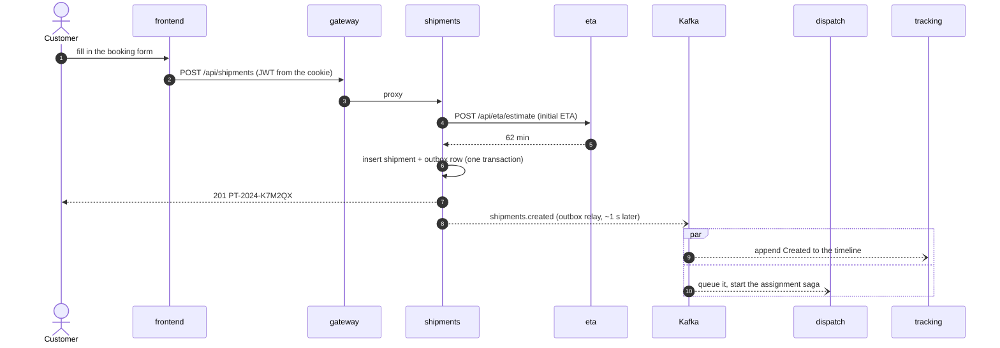
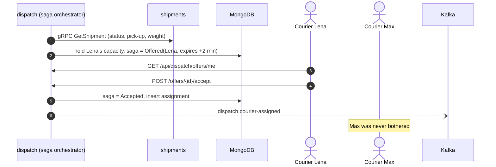
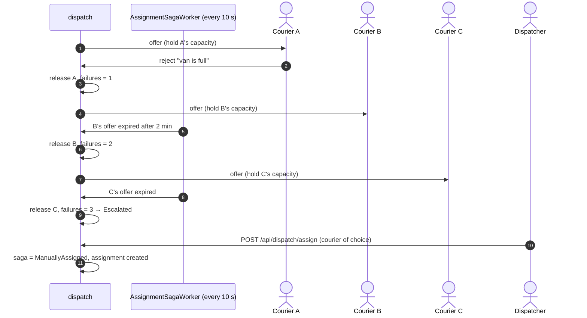
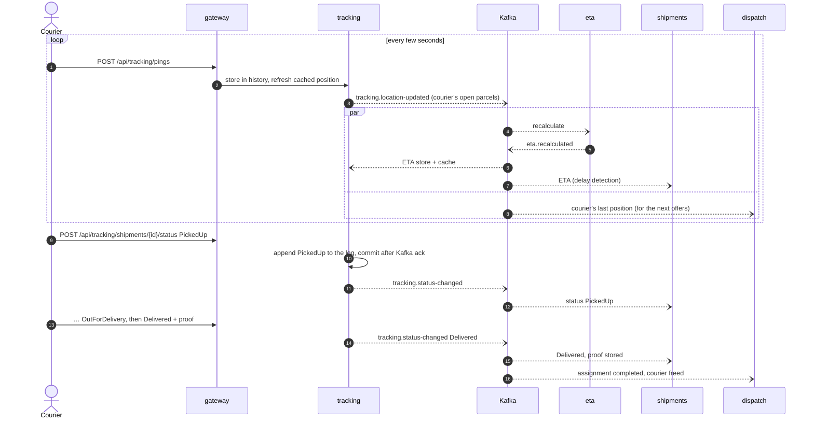
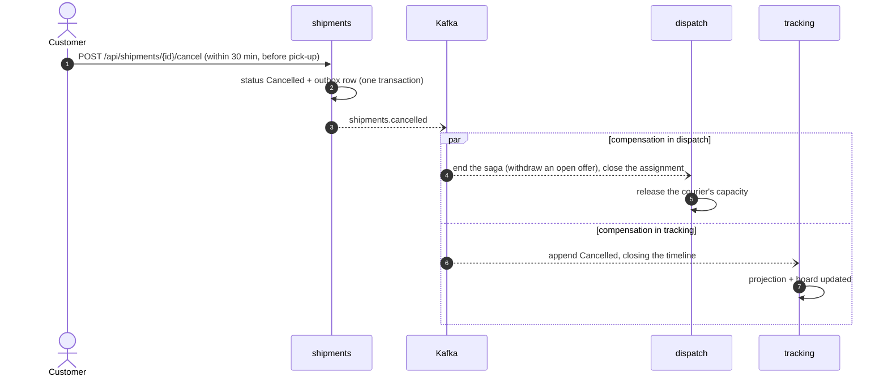
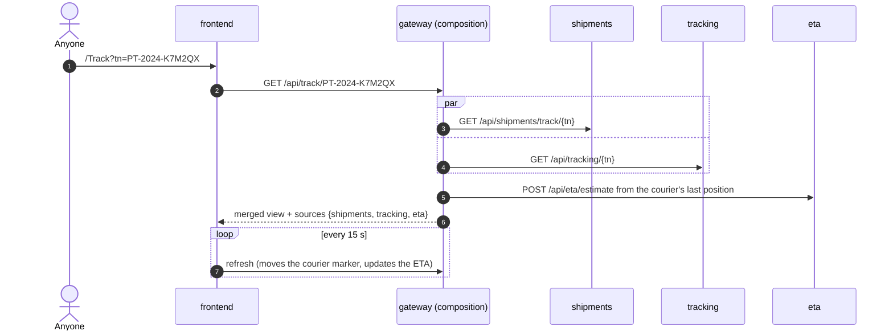
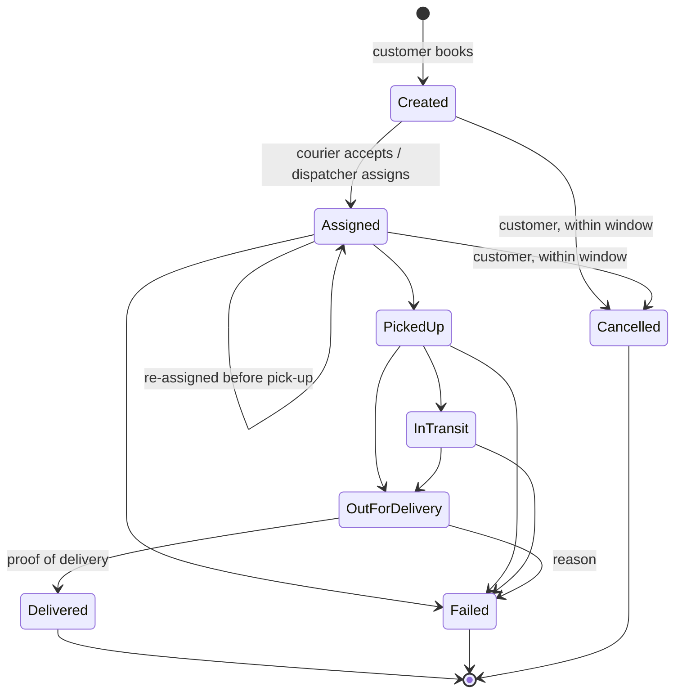
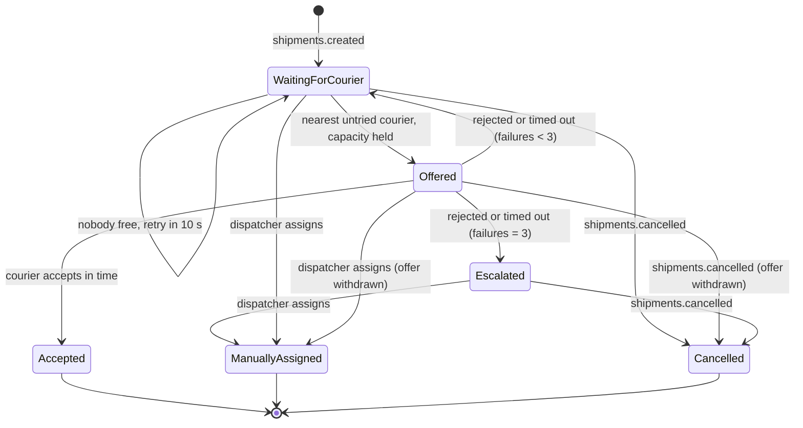

# How it works

This page follows a parcel from booking to delivery, then looks at what happens when things go
wrong. The service-level picture is in [architecture.md](architecture.md); the reasoning behind
each mechanism is in [design-patterns.md](design-patterns.md).

## 1. Booking a shipment

The customer gets the tracking number before anything is on Kafka. The outbox relay publishes
the event shortly afterwards, and it can't get lost: it is in the same transaction as the
shipment row.

**Failure path: eta is down.** The shipments → eta client gives up after a 2 s attempt timeout
(or immediately if its circuit is open). The booking still succeeds without an initial ETA; the
first courier ping produces one.

## 2. Getting a courier: the assignment saga

Dispatch orchestrates assignment as a saga with its state in Mongo
([AssignmentService](../src/services/dispatch/ParcelTrace.Dispatch/Services/AssignmentService.cs),
[AssignmentSaga](../src/services/dispatch/ParcelTrace.Dispatch/Domain/AssignmentSaga.cs)).

### Failure path: rejection, timeout, escalation

Couriers are never asked twice for the same parcel. Rejections and timeouts count the same.
After three failures the shipment moves to the top of the dispatcher's queue with an
"Escalated" badge. If no courier is free at all, the saga stays `WaitingForCourier` and the
worker retries every 10 seconds. That isn't counted as a failure.

## 3. On the road: pings, ETAs and status updates

**Failure path: events out of order.** If `PickedUp` reaches shipments before
`dispatch.courier-assigned` does (they travel on different topics), the shipment state machine
rejects it. The consumer forwards the message to `shipments.retry` and processes it again a
moment later, by which time the assignment has landed. After five failed attempts a message is
parked on `shipments.dlq`.

## 4. Cancelling after a courier was assigned (compensation)

If a courier accepts an offer at the same moment the customer cancels, both paths are safe.
The saga is saved with an optimistic version check, so only one transition wins. Any
`courier-assigned` that does slip through is ignored by shipments and tracking, because the
shipment is already terminal.

## 5. Following a parcel (public page)

**Failure path: a source is down.** With tracking down, the page shows the booking facts from
shipments and the booking-time ETA, with an empty timeline. With eta down, it shows the last
recalculated ETA. The `sources` field tells the page what is missing, and it says so in a note.

## State diagrams

### Shipment

Enforced by [ShipmentStateMachine.cs](../src/services/shipments/ParcelTrace.Shipments/Domain/ShipmentStateMachine.cs)
and [stateMachine.js](../src/services/tracking/src/stateMachine.js).

### Assignment saga

